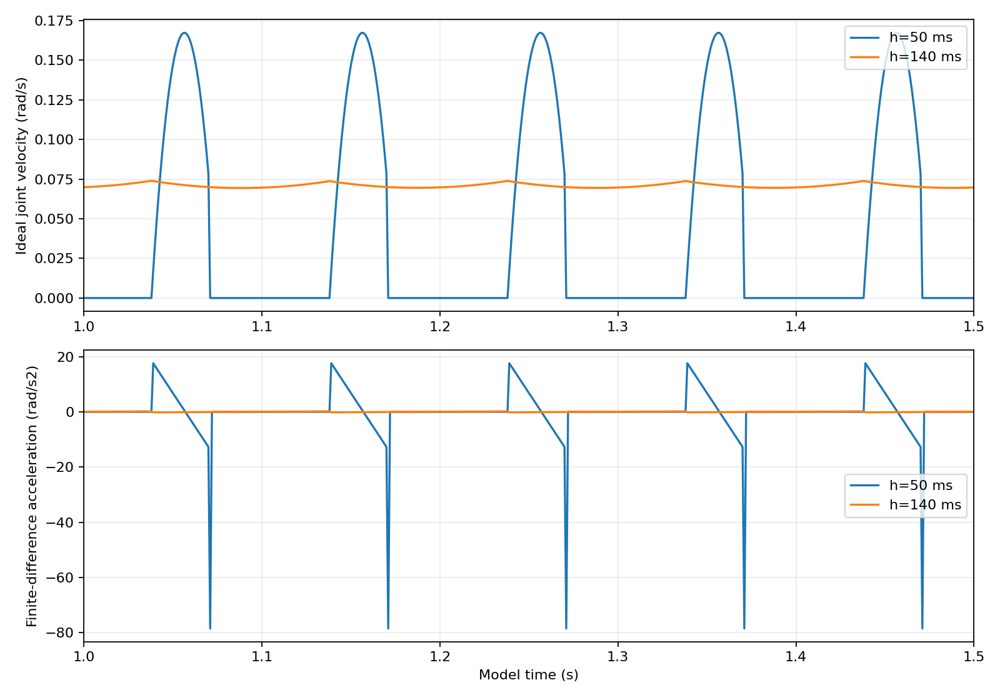

# Windows stop、时域与简化审查记录

## TASK

按用户指定顺序验证stop适配器，再单独验证时域调整，最后逐项审查简化。当前环境为Windows，容差保持5 mm。QP、100步预算、关节限制和现有网关逻辑不改，所有真实设备相关步骤留待可用的ROS及现场环境。

最小实现增加独立`stop_hold_adapter_node`与其离线编译测试；时域使用独立的Python单关节模型，不修改生产配置。增加两份说明文档、单独launch及CMake目标/离线测试注册。没有安装ROS或自动启动任何节点。

## TASK_RESULT

| 项目 | 实际结果 |
|---|---|
| Windows编译实际stop源文件，ROS接口桩 | 23场景、76断言PASS；构造/回调/服务方法实际执行 |
| stop生产默认值正向场景 | PASS；0.005 rad/s、0.2秒确认、1秒总确认期限、0.3秒新鲜度 |
| 独立时域模型 | 21案例完成；输出原始轨迹、统计和曲线 |
| 时域模型单元测试 | 4项PASS |
| 既有Python模型/误差/接线静态检查 | 14项PASS |
| 简化审查 | 7组梯度条件代数核对、居中与端点检查反例、现有看门狗条件核对完成；未实施简化 |
| 完整ROS构建/接线、Gazebo、厂家驱动、EtherCAT、实际停车 | 未验证，未运行 |

实际平台和Python版本见[verification.json](verification.json)。编译器使用已有Windows Zig C++14，没有下载新运行环境。源码运行时父提交为`c79b5f6`，新增文件由SHA256标识，不把父提交当成本次全部源码。

### 已执行命令

从仓库根目录，使用已有Python解释器：

```powershell
python test/test_stop_hold_adapter.py --zig ../build-tools/ziglang/zig.exe
python test/test_command_horizon.py -v
python scripts/validate_command_horizon.py --output ../../audit/elfin-horizon-final-2026-10-25
python test/test_real_robot_tf_and_error.py -v
```

本机实际解释器为用户此前提供的MuJoCo项目`.venv/Scripts/python.exe`，这里只复用Python/绘图依赖，没有改MuJoCo仓库。代数与配置保持核对由随归档保存的`check_elfin_simplifications.py`执行。

## stop的实际覆盖

新鲜六轴/重排名称及生产默认值可成功；以下情况均不成功：旧零速、只有一帧请求后零速、缺轴、velocity短数组、NaN、重复名称、实际或期望仍运动、速度等于阈值、旧/未来/零时间戳、缺JTC状态、command无订阅者、发布异常、发布后断连、ROS时间冻结/回退、并发请求、短暂低速后再运动。

每次有效服务请求仅发送一条空轨迹，启动不发布，忙碌/未连接时不重复发送。服务成功只表示请求后观察到两路持续低速，不是接收ACK、位姿保持证明或安全认证。新节点不随真机主launch自动启动，网关默认关闭和站点审查标志保持不变。详见[stop说明](../../stop_adapter.md)。

## 时域模型实际结果

模型含候选速度0.0785 rad/s与命令差分加速度0.2512 rad/s²，没有完整QP或真实伺服。1–4秒统计、固定采样相位下：

| 回调/时域 | 零速比例 | 峰值速度 / rad/s | 峰值差分加速度 / rad/s² |
|---|---:|---:|---:|
| 100/50 ms | 68% | 0.167320 | 78.5 |
| 100/140 ms | 0% | 0.073978 | 0.178692 |
| 假设200/140 ms | 39% | 0.120547 | 78.5 |

9组相位下50 ms零速比例51%–70%，140 ms为0。4秒停发的所选相位：50 ms时域附加位移0，140 ms为0.008690 rad；这不是实际硬件停距。dt抖动到30 ms时，factor=7产生210 ms时域，超出拟议200 ms网关上限。

不能只看巡航：140 ms名义工况起步的速度差分峰值约0.755984 rad/s²；停发后最后非零端点速度截成零，整段峰值达到78.5 rad/s²。它是理想模型1 ms差分，不是实测机械加速度，却说明延长时域不能替代受控停止。`comparison.csv`分别列起步、巡航和全程指标，未隐藏该边界。



完整条件和统计见[comparison.csv](comparison.csv)、[summary.json](summary.json)、[timer_horizon.csv](timer_horizon.csv)。生产factor仍为2.5，max_horizon仍0.15 s，没有因模型通过而写入新配置。

## 简化审查

详见[简化记录](simplification_checks.json)和[时域/简化说明](../../horizon_validation.md)。结论：

- 非奇异区梯度跳过可作为后续等价优化候选；本轮不改控制器。
- 一次保持会与150 ms候选看门狗冲突，不能单独删除重复发布。
- 居中项未经严格零空间投影，关闭可能改变XYZ；代数例差范数0.00019928，不是实际机械臂误差。
- 合法端点可产生内部越限：反例位置峰值1.000174超过1，差分加速度约2.1413。删除包络改变保护范围，不作为等价清理。
- 跨话题时间差检查和5 mm容差保持不变。

六个生产文件已与`ad25779`逐字内容核对，保持相同：两个生产YAML、QP求解器、QP控制器、网关和纯命令检查。CMake只新增独立节点和测试，没有更改原算法构建。

## 失败案例与Debug材料

1. **首轮stop夹具FAIL**：15 ms新鲜度、12 ms确认时间的fresh场景在本机失败。后改为120/40 ms测试窗口，生产参数未改；最终另跑生产默认值。不能据此声称Windows具备毫秒实时保证，原失败日志保留。
2. **时域测试首次FAIL**：原断言假设所有停发案例附加位移都必须大于0。但50 ms在所选相位已经处于等待区，最后待处理点过期，附加位移确为0。保留此结果，修正错误假设，分别检查短时域为0、长时域为正，而非修改模型来制造通过。
3. **140 ms的边界案例**：200 ms回调间隔仍有39%零速；这是模型敏感性结果，保留而不称为配置全面修复。

原始日志全部保留，包括首轮stop失败、第二轮21场景版本、最终23场景版本、时域初次失败及最终通过、21案例运行输出、14项既有检查输出。审查附录原实现的三例误成功记录也随包保留。

## 归档和下一步

`raw_evidence.zip`含20个成员：模型原始CSV/图/摘要、实际通过与失败日志、代数检查脚本与结果、此前附录反例和打包脚本。完整性清单见[manifest.json](manifest.json)，用SHA256核对。曲线来自模型数据，本轮未作实际机械臂或Gazebo观察。

下一步需要真正的ROS Melodic环境：完整构建 → 隔离stop服务/网关联动 → Gazebo → 单独50/140 ms接收时序对照。现场停止和真实运动仍按既有授权要求进行。本轮完成的是Windows可验证部分，不能据此放行真机；没有向GitHub推送。
